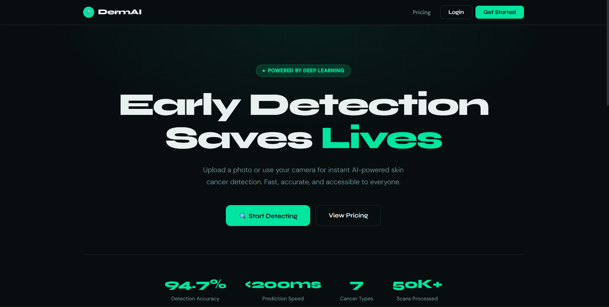
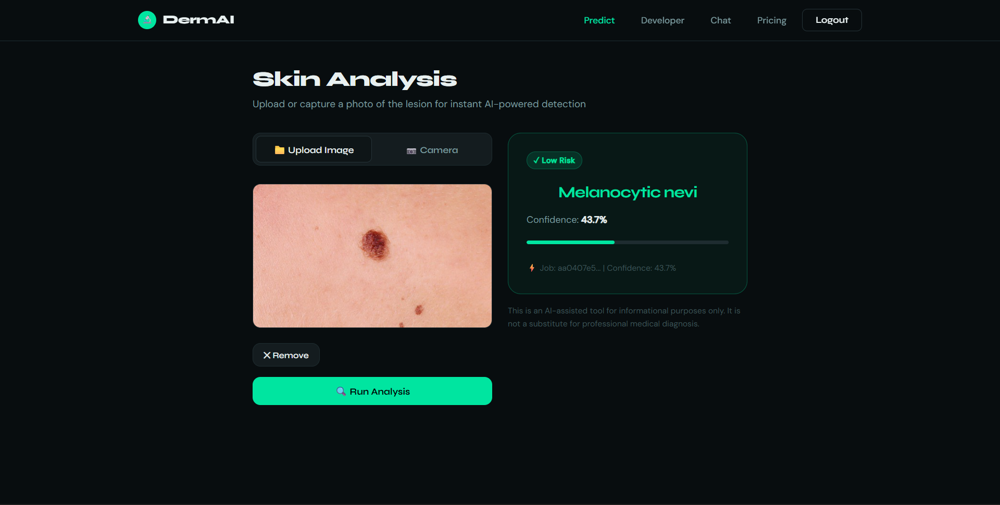

<h1 align="center">DermAI</h1>

<p align="center">Skin lesion classification with deep learning and computer vision</p>

<p align="center">
  
  
  
  
  
</p>

<p align="center">
  

  
</p>

DermAI is a web application that analyzes skin-lesion images with a deep-learning classifier. Users can upload an image or capture one with a camera, then view a predicted lesion class and confidence score. It is an educational project and is **not a medical diagnostic tool**.

## Computer vision and deep learning

The notebooks explore the image-classification workflow, from exploratory analysis and image/metadata preparation through model training and evaluation. They cover:

- **Seven-class classification:** actinic keratoses/Bowen's disease, basal cell carcinoma, benign keratosis-like lesions, dermatofibroma, melanocytic nevi, melanoma, and vascular lesions.
- **Data preparation:** inspection and cleanup of metadata, image resizing, train/validation/test splits, and class-imbalance experiments using augmentation and class weighting.
- **Model comparisons:** a multilayer perceptron (ANN), a convolutional neural network (CNN), and transfer-learning experiments with MobileNetV2, EfficientNetB0, ResNet50, and DenseNet121.
- **Segmentation exploration:** a separate U-Net notebook experiments with lesion-mask segmentation; these results are not classification scores.

### Findings in the notebooks

| Experiment | Reported result |
|---|---:|
| ANN classifier | 59.4% test accuracy |
| CNN classifier | 66.3% test accuracy |
| Transfer-learning classifier | 64% test accuracy |
| U-Net segmentation | About 94.9% validation pixel accuracy |

These are notebook-reported results, not a clinical validation or a guarantee of production performance. The U-Net score measures a different task and is not directly comparable with classification accuracy. The experiments show the importance of evaluating class-level performance and generalization, not relying on a single headline accuracy.

### Inference pipeline

The backend downloads a TensorFlow Lite model from Supabase Storage, decodes and resizes each image to **200 × 150**, scales pixel values to `[0, 1]`, and runs inference with TensorFlow Lite. The API returns the top class and its confidence, and records the image job and inference result. The notebook experiments and the model currently served by the backend are distinct; notebook scores should not be attributed to the deployed model.

## Application

- **Backend:** FastAPI, TensorFlow Lite, OpenCV, and Supabase for model/image storage and inference records; includes authentication, prediction, chat, and developer API endpoints.
- **Frontend:** Next.js 14 and React; provides image upload/camera capture, results, account pages, chat, and API-key management.

## Requirements and running locally

### Libraries

- **Backend:** FastAPI, Uvicorn, TensorFlow/TensorFlow Lite, OpenCV, NumPy, Pillow, Supabase Python client, Requests, Pydantic, python-jose, Passlib, and python-dotenv. Pinned dependencies are in [`requirements.txt`](requirements.txt), which includes [`Backend/requirements.txt`](Backend/requirements.txt).
- **Frontend:** Next.js 14, React 18, and React DOM.
- **Notebooks:** TensorFlow, OpenCV, NumPy, pandas, scikit-learn, Matplotlib, and Seaborn. Notebook-specific dependencies are not separately pinned in this repository.

Install backend dependencies from the repository root and start the API:

```bash
python -m pip install -r requirements.txt
cd Backend
uvicorn app.main:app --reload
```

Run the frontend with `cd Frontend`, `npm install`, and `npm run dev`.

### Environment variables and API keys

Create `Backend/.env` with the backend settings below. Use your own credentials; never commit this file or put server secrets in frontend variables.

```dotenv
SUPABASE_URL=https://your-project.supabase.co
SUPABASE_KEY=your-server-side-supabase-key
BUCKET=your-image-storage-bucket
GEMINI_API_KEY=your-gemini-api-key
SECRET_KEY=replace-with-a-long-random-secret
ALGORITHM=HS256
ORIGIN=http://localhost:3000
```

`SUPABASE_URL` and `SUPABASE_KEY` connect the backend to Supabase; `BUCKET` is used for uploaded images. The model loader also expects `skin_cancer_model.tflite` in the Supabase Storage bucket named `Private`. `GEMINI_API_KEY` enables the chat assistant. `SECRET_KEY` and `ALGORITHM` sign and verify JWTs; `ALGORITHM` is required by the current code. `ORIGIN` must match the frontend origin for CORS. Token lifetimes can optionally be set with `ACCESS_TOKEN_EXPIRE_MINUTES` (default `30`) and `REFRESH_TOKEN_EXPIRE_DAYS` (default `7`).

Set the browser-visible backend address in `Frontend/.env.local`:

```dotenv
NEXT_PUBLIC_BACKEND_URL=http://localhost:8000
```

`NEXT_PUBLIC_BACKEND_URL` is public configuration, not a secret. Obtain Supabase and Gemini credentials from their respective provider projects, and keep private keys server-side.

## Project layout

```text
Backend/    FastAPI application and ML inference
Frontend/   Next.js web application
Notebooks/  EDA, ANN, CNN, transfer-learning, and U-Net experiments
```

> **Medical disclaimer:** DermAI is for informational and research purposes only. It cannot diagnose skin cancer or replace evaluation by a qualified healthcare professional.
